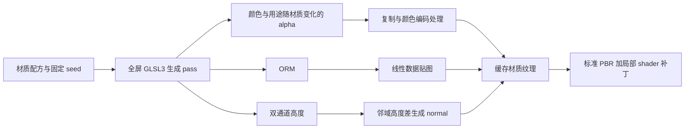

# Saltline 的材质与贴图实现

分析对象是用户下载的 [saltline.original.html](../source/saltline.original.html)，SHA-256 为 `b83fc642f3696c21a9efbf36c29bd9c0c7e1e9725fe215d4a043fa4a10bccbeb`。证据来自当前执行的第二个 `<script>`，格式化阅读副本为 [bundle-1.js](../source/extracted/bundle-1.js)。第一个 `id="legacy-v8"`、`type="application/octet-stream"` 的脚本块是惰性数据，不用于判断当前材质实现。

本页保留源码、参数和调用关系分析。后续已运行原作并导出代表性贴图，见[实机报告](runtime-findings.md)；显存和跨设备稳定性仍未测量。

## 1. 最值得学习的做法

Saltline 把大部分环境材质写成可重复的程序配方，在启动或首次使用时由 GPU 烘成普通贴图，再交给 Three.js 的标准 PBR 材质受光。运行时追加低频色差、湿润、雨水痕和距离过滤。它把昂贵的细节生成与每帧的材质采样分开了。[生成与缓存 L39532–39705](../source/extracted/bundle-1.js#L39532)

对丝袜项目最有价值的是以下方法：

- 同一结构场同时生成颜色、覆盖率、粗糙度、微法线，让细节位置一致。
- 以米为单位规定重复尺寸、以毫米为单位规定细节高度，避免换分辨率后针脚大小改变。
- 细节变小时，调整覆盖率表现和高光粗糙度，减少细线消失及亮点闪烁。
- 将基础染色与局部污损分开，使用少量配方生成多个颜色版本。
- 让湿润同时改变颜色、roughness 和微法线，而不是只加一个“亮度”参数。

这里的 `fabric` 是经纬交织的高粗糙度布面配方，不是尼龙针织丝袜模型，也没有针织力学。丝袜的拉伸密度、纱线各向异性、皮肤透出、破洞和脱卸仍需由目标项目自己的系统提供。[fabric L37825](../source/extracted/bundle-1.js#L37825)

## 2. GPU 程序贴图流水线

| 阶段 | 源码确认的实现 | 证据 |
| --- | --- | --- |
| 图案生成 | PCG 整数 hash、可周期重复的 gradient noise、FBM、Voronoi F1/F2、多尺度随机划痕 | [L37398–37445](../source/extracted/bundle-1.js#L37398) |
| 一次输出多个通道 | GLSL3 `layout(location=0..2)`；临时 `WebGLRenderTarget` 设置 `count: 3`，关闭深度和 mipmap | [L37400](../source/extracted/bundle-1.js#L37400)、[L39601](../source/extracted/bundle-1.js#L39601) |
| 颜色中间结果 | `o0.rgb = sqrt(clamp(c,0,1))`；复制 pass 再将 RGB 平方，最终 albedo target 声明 `SRGBColorSpace` | [L37442](../source/extracted/bundle-1.js#L37442)、[L37976](../source/extracted/bundle-1.js#L37976)、[L39578](../source/extracted/bundle-1.js#L39578) |
| 物理属性 | `o1 = vec4(ao, roughness, metallic, 1)`，roughness 生成时限制到 `0.03..1` | [L37444](../source/extracted/bundle-1.js#L37444) |
| 高度编码 | `hh=h*255`；R 存 `floor(hh)/255`，G 存小数；读取 `R + G/255` | [L37445](../source/extracted/bundle-1.js#L37445)、[L37966](../source/extracted/bundle-1.js#L37966) |
| 高度转 normal | 采样水平、垂直与对角共八个邻点，组合高度差为 gx/gy，再归一化 `(-gx*Kx,-gy*Ky,1)` | [L37967](../source/extracted/bundle-1.js#L37967) |
| 真实尺寸 | `tile` 定义重复大小；normal 强度采用 `bump * 0.001 * texture_resolution / tile_size`，显式含毫米到米的换算 | [L39113](../source/extracted/bundle-1.js#L39113)、[L39645](../source/extracted/bundle-1.js#L39645) |
| 缩小与斜视采样 | 最终纹理开启 mipmap，`LinearMipmapLinearFilter`、线性放大、RepeatWrapping，采样各向异性最大取设备上限与 8 的较小值 | [L39537](../source/extracted/bundle-1.js#L39537)、[L39578](../source/extracted/bundle-1.js#L39578) |
| 复用与释放 | 纹理集按配方 key 缓存，材质按颜色/双面/三平面等组合缓存；四秒未再生成时释放临时生成 target 与生成 shader | [L39562](../source/extracted/bundle-1.js#L39562)、[L39680](../source/extracted/bundle-1.js#L39680)、[L39780](../source/extracted/bundle-1.js#L39780) |

`sqrt` 和平方是这份实现的中间存储处理，不能把它当作标准 sRGB 转换公式。迁移时应分别定义“颜色编码”和“数据编码”，由 Godot 的 `source_color` 和导入设置处理颜色。ORM、高度、coverage 与 normal 都是数据，不应接受颜色 gamma 转换。官方依据见 [Godot shading language](https://docs.godotengine.org/en/stable/tutorials/shaders/shader_reference/shading_language.html#using-source-color)。

alpha 通道尤其不能统一当透明度。漆面、金属、塑料和 `fabric` 配方用它保存可被颜色参数重新染色的贡献，`chainlink` 用它保存线网覆盖率，玻璃才用它保存连续透明度。`SL_TINT` 的不同分支决定解释方式。[发射函数 L37442](../source/extracted/bundle-1.js#L37442)、[染色分支 L39444](../source/extracted/bundle-1.js#L39444)

### Godot 对应方式

先保留“生成一次，采样多次”的设计。对固定针织结构，可在工具阶段烘出 normal/coverage/roughness，再导入 Godot；颜色和应变场在运行时组合。需要编辑器内生成时，可使用 `Image`/`ImageTexture` 或 `SubViewport` 分别输出各通道。只有确认需要 GPU 大批量生成时再考虑 `RenderingDevice` 的 compute/storage image；普通材质 shader 不是这套 WebGL MRT 接口的直接替代。

Godot 的 `StandardMaterial3D`/`ORMMaterial3D` 可接收标准通道，额外的 coverage 与应变需要 `ShaderMaterial`。官方入口为 [ORMMaterial3D](https://docs.godotengine.org/en/stable/classes/class_ormmaterial3d.html)、[SubViewport](https://docs.godotengine.org/en/stable/classes/class_subviewport.html)、[compute shader 教程](https://docs.godotengine.org/en/stable/tutorials/shaders/compute_shaders.html)。这些是迁移候选，未在本轮实现或运行。

## 3. 材质配方与变体

配置中有 29 个纹理集配方、48 个公开材质预设。`anodized` 复用 `gunmetal` 生成函数，`glass_dirty` 复用 `glass`，所以实际 `cn.*` 生成函数是 27 个。颜色变体共享纹理，不是为每个红、蓝、绿版本各生成一套纹理。[配方表 L39113–39197](../source/extracted/bundle-1.js#L39113)、[预设表 L39235–39343](../source/extracted/bundle-1.js#L39235)

| 材质族 | 配方及主要机制 | 对丝袜的用途 |
| --- | --- | --- |
| 地面与墙体 | asphalt、concrete、brick、epoxy；多尺度骨料、孔洞、接缝、裂纹、油污和磨损 | 学习宏观/微观层分工，不复用其颜色和硬度 |
| 漆面与船壳 | paint、hazard、hull、armor；表漆、底漆、基底、锈斑、流挂、盐渍、焊缝 | 借鉴一个损伤场同步改变多个属性 |
| 金属 | galv、metal、brushed、rust、diamond、corrugated、gunmetal、anodized | 学习方向纹理和参数组织；不把金属反射参数迁给尼龙 |
| 聚合物 | polymer、plastic、tire；颗粒、擦白、沟槽、指印式粗糙度差异 | 可用于鞋、配饰、背景参考 |
| 纤维类 | fabric、carbon、tarp、rope、cardboard、wood | 可参考交织高度、纤维随机差异、低频污损；织法需另建 |
| 开孔与透明 | chainlink、glass、glass_dirty | 线网覆盖与透明排序可作为网袜/蕾丝的对照 |
| 水 | water | 此处是共享纹理配方；场景地面和海水还使用独立 shader，需结合地面报告 |

`fabric` 在每 tile 上安排 `36×36` 格经纬交错高度，用高频噪声和逐纱线随机量打破均匀，AO 随纱线凸起变化，roughness 固定 `0.92`、metallic 为 `0`。其 `tile=0.05`，表示五厘米重复块。它没有针织线圈结构、面料透光 BRDF 或应变传递，不能作为丝袜材质的完整替代。[L37825–37835](../source/extracted/bundle-1.js#L37825)、[L39147](../source/extracted/bundle-1.js#L39147)

`tarp` 的长垂褶和细褶写进高度场，再转换成 normal。它们改变受光，不改变真实外轮廓。`rope` 用斜向周期函数形成绞线轮廓，`carbon` 用 `2/2` 式交错规则和方向噪声表达织束。这些都属于图案与微表面近似。[tarp L37887](../source/extracted/bundle-1.js#L37887)、[rope L37915](../source/extracted/bundle-1.js#L37915)、[carbon L37814](../source/extracted/bundle-1.js#L37814)

## 4. 在标准 PBR 中插入局部规则

当前公共材质创建的是 `MeshStandardMaterial`，共享 albedo、normal、ORM，并通过 `onBeforeCompile` 替换 `map_fragment`、`roughnessmap_fragment`、`metalnessmap_fragment`、`normal_fragment_maps`、`aomap_fragment`。因此它保留 Three.js 的标准照明，仅改写材质输入和 normal，不是完全自行实现一套 BRDF。[补丁 L39507–39531](../source/extracted/bundle-1.js#L39507)、[材质创建 L39717–39766](../source/extracted/bundle-1.js#L39717)

| 局部规则 | 实现细节 | Godot 迁移 |
| --- | --- | --- |
| 可重染色材质 | `SL_TINT=1` 时使用 `sample.rgb + uniform_color * sample.a`，损伤处降低可染色贡献；另有涂覆颜色与乘色分支 | 在 spatial `fragment()` 组合 `ALBEDO`，保留 coverage 独立通道 |
| 低频打破重复 | 两个物体/世界坐标噪声层控制 albedo、粗糙度和污渍；纹理本身仍可平铺 | 袜体使用稳定材料坐标或 rest-space，避免世界噪声随角色移动而滑动 |
| 湿润分布 | 基于法线朝上程度、垂直流痕、离地距离与 interior 系数计算；室内全局湿润系数为外部的 `0.12` | 保留独立湿润场，按目标内容需要接触/水分状态驱动 |
| 湿润反射 | 降低 albedo，略提高饱和度，将 roughness 乘湿润系数，雨珠处趋向 `0.05` | 可修改 `ALBEDO`、`ROUGHNESS`、微法线强度；尼龙参数另校准 |
| 湿润法线 | 朝上且湿润的区域降低 normal XY 强度，最大缩减因子受 `0.45*wetness*up` 控制 | 作为微凹槽被液体填平的近似，不能据此模拟布料体积 |
| 三平面映射 | 三轴采样按 `abs(normal)^6` 归一化混合；重建三轴 normal，并处理 skinning/instancing 后的方向轴 | 刚性附件可用内置 triplanar；主袜体优先稳定 UV 与纱线切线 |

湿润和低频变化见 [L39375–39458](../source/extracted/bundle-1.js#L39375)，三平面与 normal 重建见 [L39345–39369](../source/extracted/bundle-1.js#L39345)、[L39488–39504](../source/extracted/bundle-1.js#L39488)。

该公共模块没有 POM 的视线步进，也没有把高度图接成真实顶点位移。高度图只用于生成 normal。当前材质创建路径没有启用 `MeshPhysicalMaterial`、clearcoat、transmission 或纱线各向异性 BRDF。完整 Three.js 库中的这些类和 shader 片段存在，不代表游戏启用。`texture.anisotropy=8` 是纹理过滤，与材质各向异性高光不同。[材质创建 L39717](../source/extracted/bundle-1.js#L39717)

## 5. 远距离细线与高光稳定性

### 线网覆盖率

`chainlink` 先生成两组对角线，用圆形截面和交替高低表达交叉压叠，并按生成 texel 尺寸软化 alpha 边缘。运行时根据 `fwidth(slUv)*512` 估计 LOD，逐步降低裁切阈值，使细线缩小时仍有幸存片段；更远时过渡到基于 `gl_FragCoord` 的固定抖动阈值，同时将剩余线色降到原来的约 `0.45`，避免稀疏样本过亮。[生成 L37770](../source/extracted/bundle-1.js#L37770)、[LOD L39459–39471](../source/extracted/bundle-1.js#L39459)

这对网袜和蕾丝有直接研究价值，但代码中的 `512` 是硬编码。迁移时应使用实际 texture size 和织法周期，不照搬阈值；当前 low 档纹理尺寸可能与该估计不同。固定屏幕抖动在相机运动中的观感仍待实机验证，不能仅凭注释称为时间稳定。

Godot 可用 alpha scissor/hash、alpha antialiasing 和显式 coverage mipmap 做对照。连续薄纱则仍需评估 alpha blend 与阴影代理，线网二值覆盖方案不能自动解决薄纱透光。[Godot 透明模式](https://docs.godotengine.org/en/stable/tutorials/3d/standard_material_3d.html#transparency)

### normal 方差转 roughness

普通 UV 分支读取 mipmap 后的 normal RGB，计算未重新归一化向量长度。方向互相抵消会使平均 normal 长度变短，代码把 `1-length(normal)` 作为额外粗糙度项，最终 `roughness=sqrt(r²+variance*0.6)`，再限制到 `0.045..1`。这是 Toksvig 类思想的工程近似，源码没有给出算法出处，不能声称完全实现了某篇论文。[L39472–39485](../source/extracted/bundle-1.js#L39472)

丝袜的纱线微法线在缩小时也会出现亮点闪烁，可以研究同类的方差补偿。需要保留 mipmap 中的方向平均信息；如果图像处理流程提前把每级 normal 都归一化，长度统计就无法表达原始方差。当前实现对三平面分支没有启用这一补偿，应单独检查。MSAA 不能代替这类 shader 内过滤。

雨珠细节也使用 `fwidth(vSlPos)` 估计屏幕大小，远处直接淡出，避免为不可分辨细节继续生成高频亮点。[L39436–39442](../source/extracted/bundle-1.js#L39436)

## 6. Canvas 贴花与字体

标识、编号、警示符号由 Canvas 2D 绘制。文本按字测量与排版，部分字形用 `destination-out` 切出模板喷漆的连接桥，再用固定 seed 的斑点、划痕和渐变擦除做旧。纹理声明 sRGB，开启 mipmap 和各向异性过滤。材质透明、关闭 depthWrite，通过负 polygon offset 避免与底面 Z-fighting。字体加载完成后会重新绘制文字贴图。[做旧与字形 L38025–38103](../source/extracted/bundle-1.js#L38025)、[贴花材质 L38104–38163](../source/extracted/bundle-1.js#L38104)、[字体重绘 L39085](../source/extracted/bundle-1.js#L39085)

Godot 可在工具阶段把标识烘成贴图，使用 `Decal` 或轻微偏移的贴花网格；动态编号可用 `SubViewport` 生成。丝袜图案、接缝、徽标若要随布面变形，优先在同一 UV 空间合成，避免另一个刚性投影贴花穿帮。字体和贴图的授权需要按各自来源保留，不因程序生成而自动成为可自由发布的资源。

## 7. 迁移优先级与待验证项

| 优先级 | 适合迁移的知识 | 与 `stocking-lab` 的关系 |
| --- | --- | --- |
| P0 | 通道语义、颜色空间、实际尺寸、稳定 UV | 先保留现有 knit normal/coverage/glint 与 fabric 数据接口，补齐参数和来源记录 |
| P1 | coverage 远距过滤、normal 方差 roughness 补偿 | 现有 derivative fade 可作为基线，后续做单因素对照，不直接替换 |
| P1 | 一个结构场生成多个材质属性、配方和颜色变体分离 | 适合扩展针织、网眼、蕾丝预设，避免不一致的独立随机贴图 |
| P2 | 湿润与表面污染的多属性变化 | 仅在丝袜项目确实需要时加入；保留与物理求解分开的状态 |
| P2 | 工具阶段 GPU 烘图与缓存 | 先确认材质生成是否构成实际瓶颈；固定资产可离线生成 |
| 仅作参考 | 金属锈蚀、船壳焊缝、地面水膜 | 场景内容，不是尼龙丝袜光学或力学模型 |

待用户允许运行后，再检查不同档位的贴图尺寸与生成开销、normal 方向与强度、线网斜视/远距覆盖率、慢速转镜的抖动、湿润高光和阴影、透明玻璃及袜体的叠层排序。当前已完成其中的原作采集与独立Godot实验，范围见[实机报告](runtime-findings.md)，丝袜目标项目未运行或改动。
